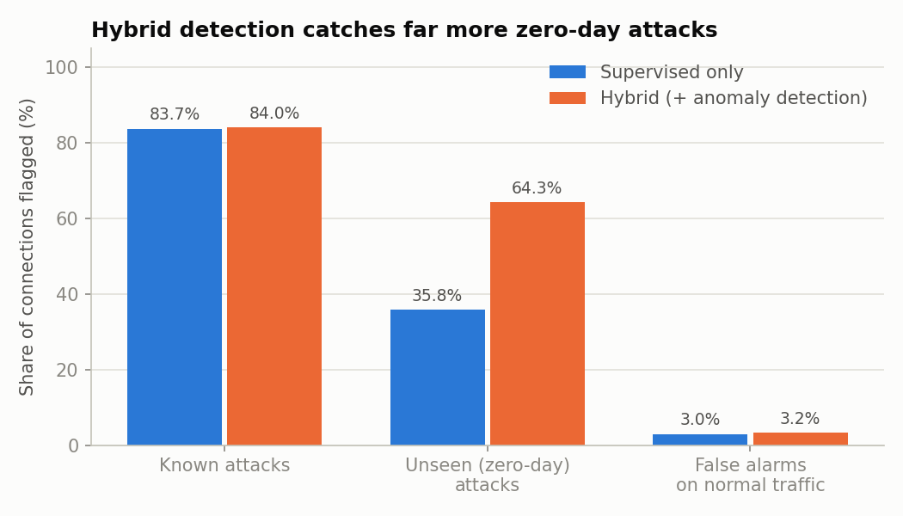
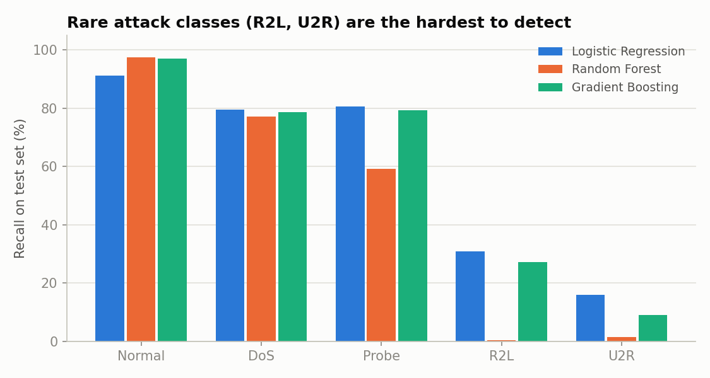
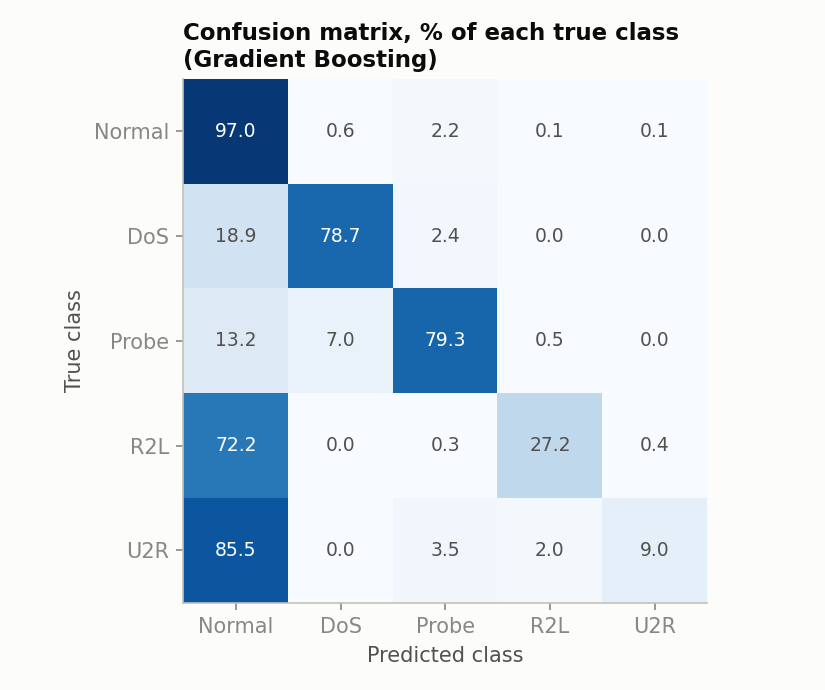

# Hybrid Network Intrusion Detection System

A machine learning intrusion detection system (IDS) that classifies network connections as normal traffic or one of four attack types, and uses anomaly detection to catch **new attacks the model has never seen before**.

Most ML intrusion detection projects report 99% accuracy using a random train/test split. That number is misleading, because real networks face attacks that weren't in the training data. This project evaluates on the official NSL-KDD test set, which contains **17 attack types that never appear in training** (3,750 connections), and shows how a hybrid design nearly doubles detection of these zero-day attacks.

## Results

Trained on 125,973 connections (KDDTrain+) and tested on 22,544 connections (KDDTest+).

### Hybrid detection

| Approach | Attacks detected | Zero-day attacks detected | False alarm rate |
|---|---|---|---|
| Gradient Boosting classifier only | 69.7% | 35.8% | 3.0% |
| Isolation Forest (anomaly) only | 62.2% | 59.3% | 1.9% |
| **Hybrid (classifier + anomaly)** | **78.2%** | **64.3%** | **3.2%** |

The hybrid system raises zero-day detection from **35.8% to 64.3%** while false alarms rise by only 0.2 percentage points.



### Multi-class classification (test set)

| Model | 3-fold CV macro-F1 | Test accuracy | Test macro-F1 |
|---|---|---|---|
| Logistic Regression | 0.719 | 78.1% | 0.598 |
| Random Forest | 0.904 | 73.9% | 0.473 |
| **Gradient Boosting (selected)** | **0.920** | **79.7%** | **0.614** |

Cross-validation scores are much higher than test scores. That gap is the distribution shift caused by unseen attacks: the model does well on attacks it has learned, but struggles on new ones.



**Per-class recall (Gradient Boosting):** Normal 97.0%, DoS 78.7%, Probe 79.3%, R2L 27.2%, U2R 9.0%. R2L and U2R are hard because they are rare in training (995 and 52 rows) and most of their test examples are new attack types.



## How it works

```
               ┌─────────────────────────────┐
connection ──► │ Gradient Boosting classifier │──► Normal / DoS / Probe / R2L / U2R
      │        └─────────────────────────────┘                │
      │        ┌─────────────────────────────┐                ▼
      └──────► │ Isolation Forest (trained   │──► anomaly? ──► ALERT if either
               │ on normal traffic only)     │                 stage says attack
               └─────────────────────────────┘
```

1. **Label mapping** – 39 raw attack names are grouped into the four standard categories: DoS, Probe, R2L (remote to local) and U2R (user to root).
2. **Preprocessing** – `duration`, `src_bytes` and `dst_bytes` are log-transformed because they range from 0 to over a billion. Numeric features are standardised, and `protocol_type`, `service` and `flag` are one-hot encoded with `handle_unknown="ignore"`. The constant column `num_outbound_cmds` is dropped. Everything runs inside a scikit-learn `Pipeline` to avoid data leakage.
3. **Class imbalance** – balanced class weights, so rare classes like U2R are not ignored.
4. **Model selection** – three classifiers compared with stratified 3-fold cross-validation using macro-F1, which weighs every class equally. Gradient Boosting scored highest.
5. **Anomaly detection** – an Isolation Forest learns what normal traffic looks like. Its alert threshold is set on held-out normal data so that about 2% of normal connections score above it. The test set is never used for any choice.
6. **Hybrid decision** – an alert is raised if the classifier predicts an attack **or** the anomaly detector finds the connection unusual. Connections flagged only by the anomaly detector are labelled "Unknown anomaly".

## Project structure

```
Hybrid-Network-Intrusion-Detection-System/
├── data/                   # KDDTrain+.txt and KDDTest+.txt (downloaded)
├── models/ids_model.joblib # saved classifier + anomaly detector (created by train.py)
├── reports/
│   ├── metrics.json        # every evaluation number
│   └── figures/
├── src/
│   ├── download_data.py    # fetches the dataset
│   ├── data_prep.py        # column names, attack-category mapping, loading
│   ├── train.py            # training, evaluation, hybrid detection, charts
│   ├── predict.py          # score new connections
│   └── plot_style.py
└── requirements.txt
```

## How to run

```bash
pip install -r requirements.txt
cd src
python download_data.py   # skip if data/ already has the files
python train.py           # about 4-5 minutes
python predict.py         # scores the test file and prints a summary
```

## Dataset

NSL-KDD, from the Canadian Institute for Cybersecurity, University of New Brunswick: https://www.unb.ca/cic/datasets/nsl.html

M. Tavallaee, E. Bagheri, W. Lu and A. Ghorbani, "A Detailed Analysis of the KDD CUP 99 Data Set," IEEE Symposium on Computational Intelligence for Security and Defense Applications (CISDA), 2009.

## Tech stack

Python, Pandas, NumPy, Scikit-learn, Matplotlib, Joblib

## Possible extensions

- Evaluate on a newer dataset such as CIC-IDS2017
- Replace the Isolation Forest with an autoencoder trained on normal traffic
- Add SHAP explanations so a security analyst can see why each alert fired
